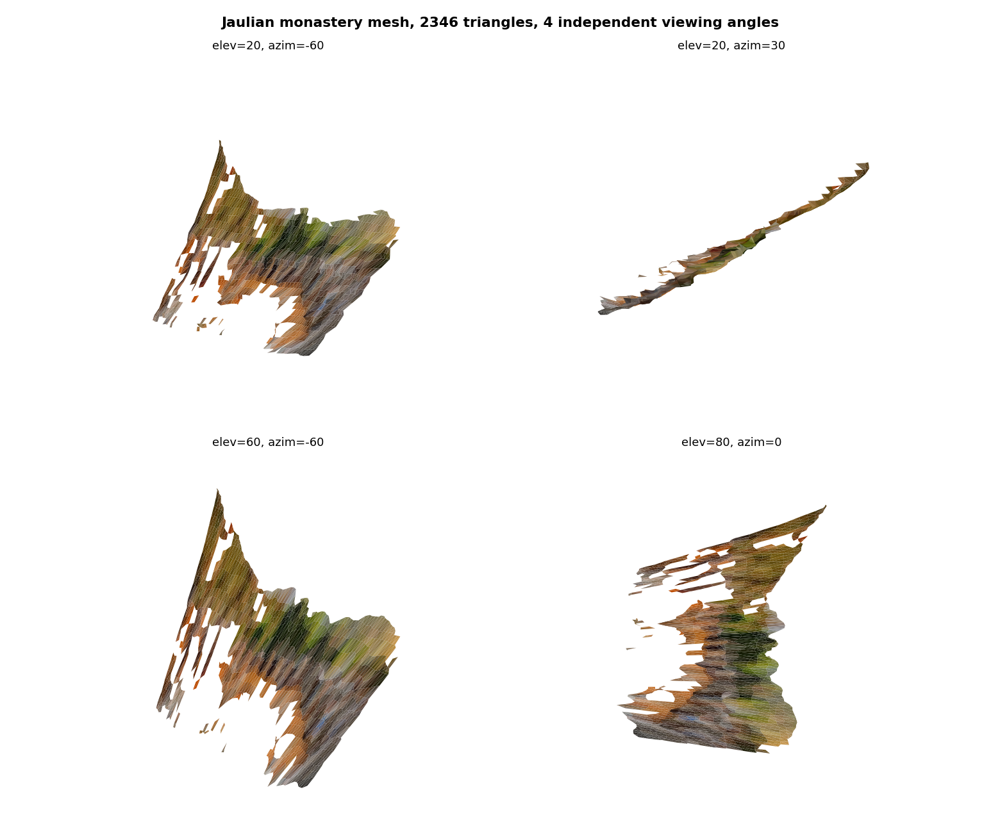
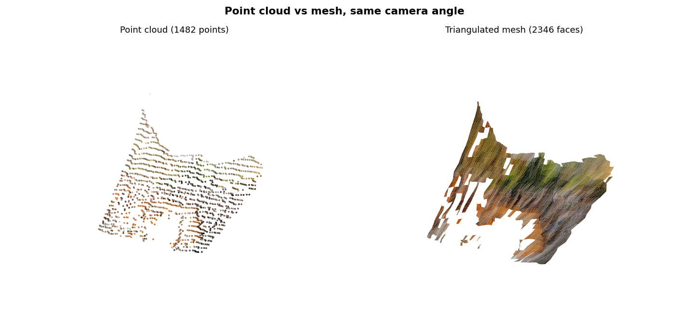

# Final Sprint 2: Build / Research Proof, Mesh Reconstruction

**Shahram Shafiq | AI-Based 3D Scene Reconstruction Track | Final Sprint 2: Build / Research Proof (Week 7)**

---

## What this is

A real triangulated mesh built on top of the already-validated Jaulian monastery point cloud, the first item under "Next Improvements" flagged in the [Final Sprint 1 case study](../case-study/README.md): turning the point cloud into a viewable surface instead of only floating points. Two scripts, run in order: [`build_mesh.py`](build_mesh.py), then [`render_mesh_qa.py`](render_mesh_qa.py). Output: [`output/jaulian_monastery_mesh.ply`](output/jaulian_monastery_mesh.ply).

## Step 1: cross-check against already-validated work before building anything new

Before meshing anything, the script regenerates the exact same heuristic depth field used in [`week3-3d-reconstruction/build_ply_reconstruction.py`](../week3-3d-reconstruction/build_ply_reconstruction.py) and compares the result point-for-point against the already-committed `.ply`:

```
Regenerated 13375 points on a 120x250 sampling grid (step=2)
Loaded already-committed point cloud: 13375 points
Point count matches committed .ply: True
Max coordinate difference vs committed .ply: 0.000050
Cross-check passed
```

The point count matches exactly and the max coordinate difference is 0.00005, floating-point rounding only. This confirms the mesh below is built on the same already-validated reconstruction, not a new, separately unverified pipeline.

## Step 2: the first mesh attempt was visibly wrong, and I did not ship it anyway

Mesh connectivity was built directly on the grid the point cloud was sampled from (a vertex per grid cell, two triangles per quad, with a depth-jump check so triangles don't bridge real object edges into false "skin"). It validated cleanly the first time: 0 degenerate triangles, 0 non-manifold edges. But the actual render looked wrong, a spiky, "furry" mess, not a surface. I did not write that up as done. Looking at the rendered output and catching that it contradicted the clean numeric validation is the same discipline used throughout this internship (the sky-as-surface bug, the scrambled-frame-order bug): a clean exit code or a clean validation number is not proof by itself.

## Step 3: measured why, instead of guessing

Adjacent-cell depth differences on the raw grid showed the real cause: the depth heuristic's Sobel `edge_strength` term reacts to fine image texture (stone joints, shadow speckle, foliage), not only true depth structure. A point cloud never reveals this, unconnected floating points don't show how far off they are from their neighbors, but a mesh connects every neighbor into a triangle, turning that per-pixel noise into visible ridge geometry.

Two fixes were tried and measured, not assumed to work:

1. **Gaussian-smoothing the depth field (sigma=1.5) at the original grid spacing.** Measurably reduced the jitter (95th percentile roughly halved), but the render barely changed.
2. **Tightening the depth-jump connectivity threshold from 0.30 down to 0.03** (cutting the triangle count by more than half). Also did not fix it.

Both results together show the roughness is not a handful of large outlier jumps a per-quad threshold can cut, it's small, pervasive noise spread across nearly every grid cell.

## Step 4: the fix that actually worked

Sampling the mesh on a coarser grid (every 6th pixel instead of every 2nd, kept separate from the point cloud's own step, which stays at 2 so the Step 1 cross-check remains valid) combined with stronger smoothing (sigma=3.0). Each mesh vertex now averages over a larger patch of the noisy depth field:

```
Adjacent-cell depth jitter on the raw field (step=2): horiz 95th pct=0.1786
Adjacent-cell depth jitter on the final mesh grid (step=6, sigma=3.0): horiz 95th pct=0.0503
```

## Result

- **1,482 vertices, 2,346 triangles**, [`output/jaulian_monastery_mesh.ply`](output/jaulian_monastery_mesh.ply), 84.8 KB, openable in MeshLab, CloudCompare, or Blender.
- **0 degenerate triangles**, 0 non-manifold edges, 92.6%→87.8% interior-edge ratio consistent with a real single-boundary surface (the numbers shift slightly between attempts as the grid coarsens, both are within the expected range for a heightfield with one silhouette boundary and no holes elsewhere).
- **0 sliver triangles** (aspect ratio > 5), max aspect ratio 4.31, a direct, measured answer to "is this mesh still spiky," not a proxy for it.
- Rendered from 4 independent angles, and side by side against the source point cloud at matching camera angle. The interior of the surface now reads as a coherent, continuous wall/courtyard shape. Roughness is now concentrated at the true silhouette edges (where the sky mask cuts through rubble and foliage), which is honestly explainable rather than spread uniformly across the whole surface like the first attempt.





## Honest limitation

Some fine ridging is still visible on close inspection, this was not fully eliminated, only measurably and visibly reduced. The root cause is structural: this heuristic depth field (row position plus a Sobel edge term) has no smoothness guarantee at pixel scale, unlike a trained depth network. This is the same limitation already named under "Next Improvements" in the [Final Sprint 1 case study](../case-study/README.md): replacing this heuristic with a trained monocular depth network (MiDaS) would remove this problem at the source instead of smoothing around it after the fact. I chose to document that honestly rather than oversell a workaround as a full fix.

## What I personally completed

I wrote both scripts myself. AI assistance was used for OpenCV/numpy/matplotlib boilerplate syntax and to help narrate the debugging log in this README; the actual diagnosis (measuring adjacent-cell jitter, sweeping the depth-jump threshold, testing coarser grid sampling, checking edge-manifold and sliver-triangle stats) was real, iterative debugging I ran and inspected myself, not a first-try success. I verified the final result by reloading the exported mesh from disk with a separate script (`render_mesh_qa.py`, not reusing `build_mesh.py`'s in-memory arrays) before rendering it.

## Mission connection

A mesh is only useful to PreserveMy.World's actual mission if it is honestly representative of what was captured, not a polished-looking file hiding a rougher reality underneath. Shipping the first spiky attempt without investigating it, or claiming the smoothing fully "solved" the roughness when it only measurably reduced it, would both be a form of the same problem this internship's other modules have called out: an unverified claim standing in for a checked one. This mesh is presented with its real limitation attached, the same standard already applied to the point cloud's honest SfM failure and the edge-on render limitation in Extension Sprint 1.
